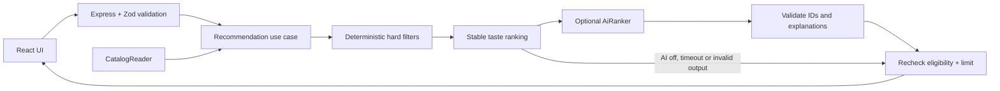

# Sufra — restaurant menu matching

A small interview-ready application built with **Node.js, Express, React and TypeScript**. Customers choose a budget, diet, excluded allergens and flavors, then get ranked menu recommendations with explanations.

The project is independent of Taqeem. It creates no database, credentials, cloud services or deployment. The default demo needs no API key.

## Run locally

Use Node **22.12+** (verified with Node 24.14) and npm.

```sh
npm ci
npm run dev
```

Open **http://127.0.0.1:5173**. Express runs on port 4000 and Vite proxies `/api` to it. `Ctrl+C` stops both processes. Dependencies are installed already in this workspace.

For a single-process production preview:

```sh
npm run build
npm start
```

Open **http://127.0.0.1:4000**. Express serves the built React app and the API from the same origin. No CORS configuration or browser-side credentials are needed. Images and fonts are bundled locally.

```sh
npm run typecheck
npm test
npm run build
# Or run all three:
npm run check
```

## What it does

- Fourteen sample dishes priced in Jordanian dinars, across bowls, mains, salads, sides and desserts.
- Strict budget, vegan/vegetarian, category and excluded-allergen filtering on the server.
- Flavor matching and a small keyword-based craving signal; stable, explainable ranking without external services.
- Optional AI ordering and taste explanations, with automatic deterministic fallback.
- Responsive React interface with applied-filter summaries, loading/error/empty states, accessible dish dialogs and favorites stored in the browser.
- Request validation, 8 KB JSON body limit, security headers, a local-demo rate limit of 60 API requests/minute/IP and request IDs. Logs contain method, path, status and duration, never preference bodies or credentials.

“Ingredients to avoid” refers to the nine explicitly modeled allergens. Free-text cravings are **soft preferences** and never substitute for the structured filters. Sample nutrition and food imagery are illustrative. Real food allergy support needs complete restaurant-verified recipes and cross-contact data.

## Modular monolith

One Express process, clear domain modules, no network calls between modules:

```text
sufra/
├── apps/api/src/
│   ├── server.ts                 # Composition root: environment + provider wiring
│   ├── app.ts                    # HTTP policy, routes, tracing and errors
│   └── modules/
│       ├── catalog/
│       │   ├── index.ts          # Public CatalogReader boundary + catalog route
│       │   └── catalog-data.ts   # Read-only sample repository
│       └── recommendations/
│           ├── index.ts          # Public HTTP/module boundary
│           ├── domain.ts         # Pure eligibility rules and baseline ranking
│           ├── service.ts        # Use case, provider validation, fallback
│           └── ai-ranker.ts      # AiRanker port + OpenAI adapter
├── apps/api/test/                # Domain, HTTP, fake-provider integration tests
├── apps/web/src/                 # React UI; no direct provider calls
├── packages/contracts/src/      # Shared TypeScript DTOs + Zod request schema
└── docs/                        # Interview walkthrough, decisions and QA evidence
```

`recommendations` imports only the catalog's public `CatalogReader` interface. Its domain code has no Express, persistence or AI dependencies. `createApp` and the recommendation service accept dependencies explicitly, so tests can replace the catalog and AI provider without mocking globals. Contracts contain no repository internals or secrets.



### Ranking and constraints

1. Validate the request strictly; reject unknown fields and invalid types.
2. Apply all hard filters. Price comparisons use integer **fils**, with 1 JOD = 1,000 fils, and the maximum is inclusive.
3. Score eligible dishes: **10 points per selected flavor match**, plus **2 per distinct craving keyword match**, capped at four keywords. Ties prefer lower price, then stable dish ID. This score is a sorting heuristic, not a confidence percentage.
4. If deliberately requested and configured, ask AI to reorder **only** eligible IDs and add short taste explanations.
5. Require each eligible ID exactly once, reject duplicates, omissions, invented IDs, empty/oversized explanations and incomplete/refused responses. Join the result to trusted catalog records. AI never supplies prices, ingredients or dietary facts.
6. Recheck eligibility and apply the result limit. If no dish fits, return an empty result without relaxing constraints or calling AI.

Exclusion counts in API metadata overlap: a dish can fail more than one rule. The catalog has only 14 dishes, so filtering is an intentional O(n) scan. A database, vector store, queue and separate services would add complexity without improving this demo.

## API examples

```sh
curl http://127.0.0.1:4000/api/health
curl http://127.0.0.1:4000/api/menu
curl -X POST http://127.0.0.1:4000/api/recommendations \
  -H 'Content-Type: application/json' \
  -d '{"maxPriceFils":6500,"diet":"vegan","excludeAllergens":["sesame"],"flavors":["spicy","smoky"],"mood":"lentil","limit":3,"useAi":false}'
```

The last request returns **Chili lentil bowl**, **Batata harra**, and **Garden quinoa salad**, all vegan, sesame-free in the sample recipe and within 6.50 JOD. For “no dairy,” select `milk` under excluded allergens.

| Field | Contract |
| --- | --- |
| `maxPriceFils` | Required integer, 0–50,000; inclusive maximum per dish |
| `diet` | `any` (default), `vegetarian`, `vegan` |
| `excludeAllergens` | Array of `milk`, `egg`, `wheat`, `sesame`, `peanut`, `tree-nut`, `soy`, `fish`, `shellfish` |
| `flavors` | Array of `fresh`, `smoky`, `spicy`, `comforting`, `tangy` |
| `category` | `any` (default), `bowls`, `mains`, `salads`, `sides`, `desserts`; available in API |
| `mood` | Optional soft preference, maximum 300 characters |
| `limit` | Integer 1–6, default 3 |
| `useAi` | Boolean, default false |

Responses contain recommendations and `meta` with `mode`, fallback reason where applicable, eligible/total counts, overlapping exclusion counts, request ID and duration. Errors use `{ "error": { "code", "message", "requestId", "fields"? } }`. Invalid input returns 400, oversized bodies 413, rate limits 429 and missing API routes 404.

## Optional live AI

No live AI request was made during development. The provider is tested using fake HTTP responses and fake adapters.

To enable it yourself, create `.env` at this project root from `.env.example`. Supply an existing key and compatible model, and deliberately set `AI_ENABLED=true`:

```dotenv
AI_ENABLED=true
OPENAI_API_KEY=your-existing-key
OPENAI_MODEL=gpt-4o-mini
AI_TIMEOUT_MS=5000
```

Restart the server. The UI then enables **Personalize with AI**. Even when configured, a request calls AI only when its `useAi` flag is true. Keys stay on the server. Live provider requests may incur charges. The adapter uses the [OpenAI Responses API with Structured Outputs](https://developers.openai.com/api/docs/guides/structured-outputs), `store:false`, a bounded timeout (default 5 seconds, maximum 15) and no automatic retries. Only the taste text and eligible dish names/ingredients/flavors are sent; no user profile, account or history exists.

Missing credentials, disabled AI, rate limits, timeouts, refusals or invalid output keep the deterministic matcher available. Explanations from AI are separated from catalog facts and labeled in the UI. Structured output and prompts constrain format and content, but do not prove that natural-language explanations are factually correct.

## Interview materials

- [Five-minute demo and talking points](docs/INTERVIEW.md)
- [Verification record and limits](docs/QA.md)
- [Asset credits](docs/ASSETS.md)

This is a local, single-restaurant showcase. Production work would add a persistent catalog repository (for example Postgres), verified allergen data, authentication for menu administration, suitable abuse controls, AI budget controls/caching, centralized telemetry and evaluations. See the interview guide for the tradeoffs.
